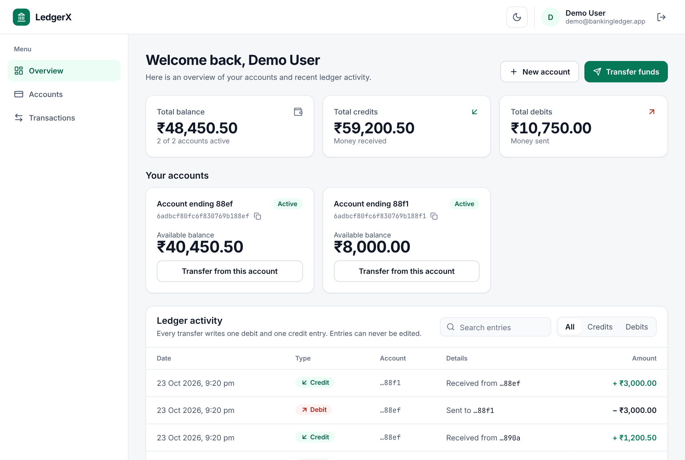
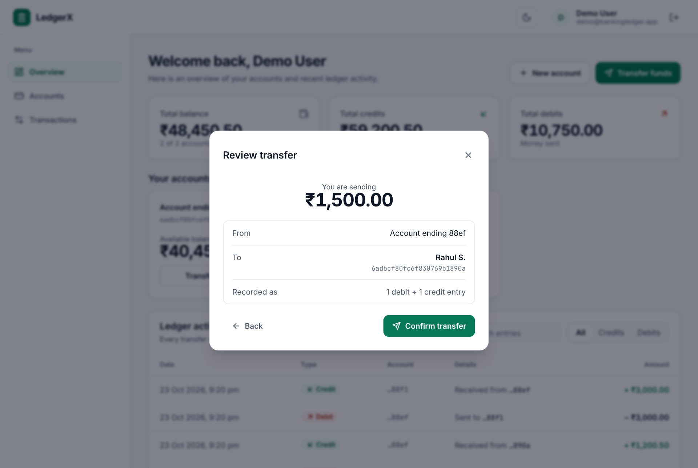
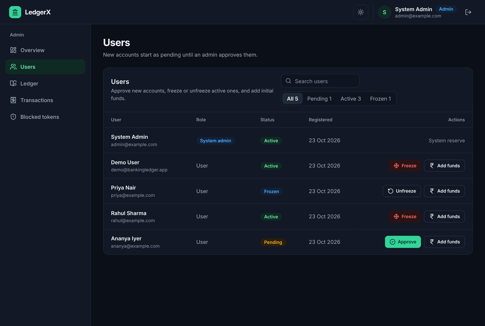
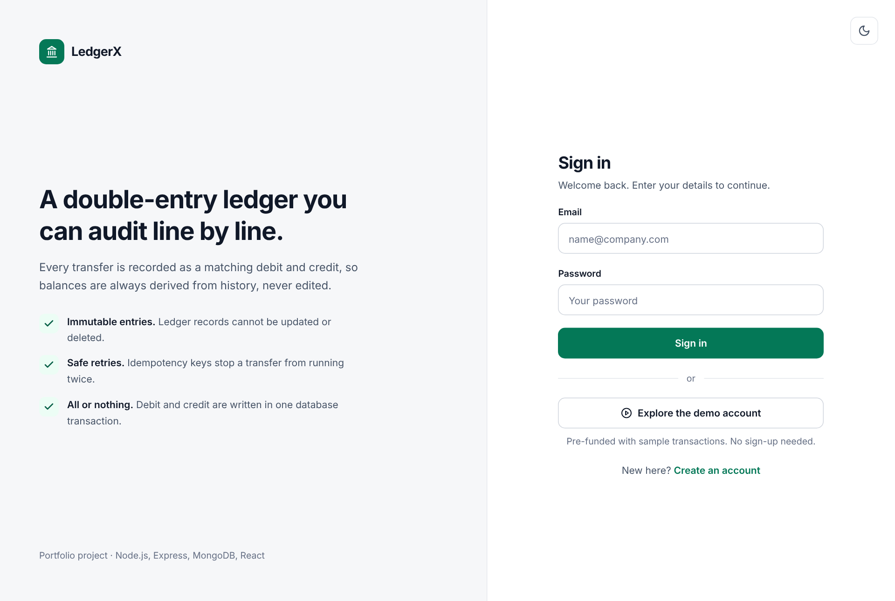
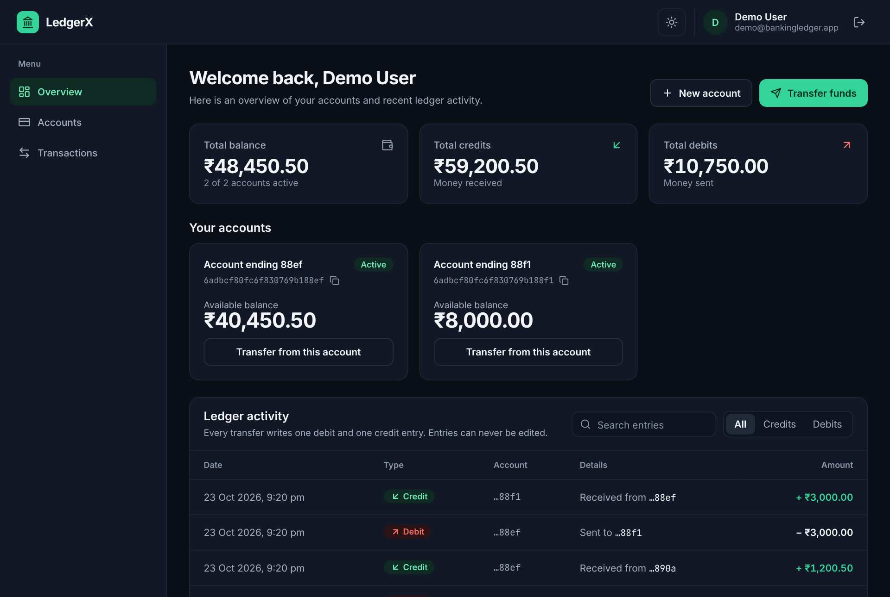
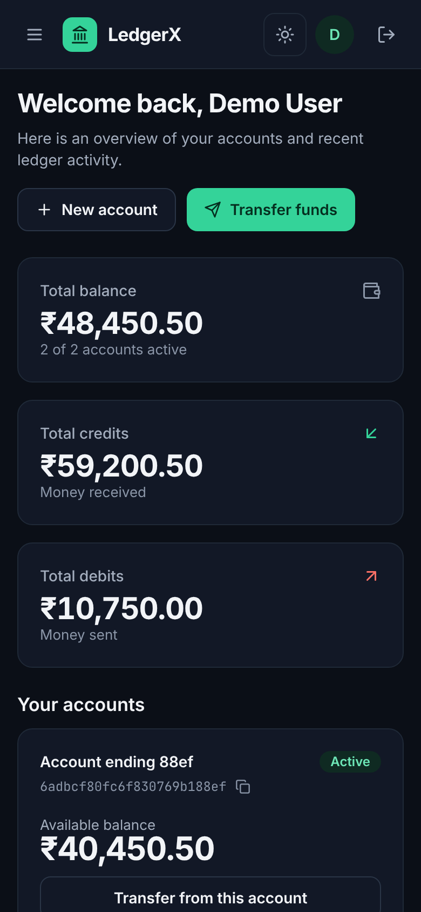
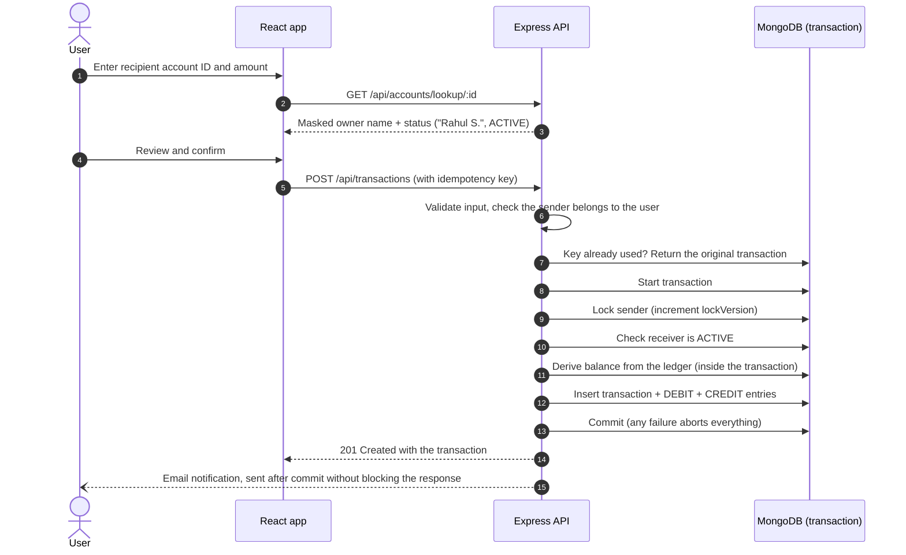

# LedgerX: Banking Ledger & Transaction Management System

A full-stack double-entry banking ledger. Balances are derived from an immutable ledger, transfers are atomic and idempotent, and concurrent transfers can never overdraw an account.

[](https://github.com/arungujjar123/Banking-ledger-transaction-management-system/actions/workflows/ci.yml)
[](https://banking-ledger-lpzw.onrender.com)
[](https://banking-ledger-lpzw.onrender.com/api/docs/)


**Try it:** open the [live demo](https://banking-ledger-lpzw.onrender.com) and click **Explore the demo account**. No sign-up needed; the demo account is pre-funded with sample transactions.

> The demo runs on Render's free tier, which sleeps after 15 minutes of inactivity. The first request can take 30 to 60 seconds while it wakes up.



| Review before sending | Admin console (dark theme) |
|---|---|
|  |  |

| Sign in | Dark theme | Mobile |
|---|---|---|
|  |  |  |

---

## Highlights

- **Double-entry bookkeeping.** Every transfer writes exactly one `DEBIT` and one `CREDIT` entry. The sum of all debits always equals the sum of all credits.
- **Derived balances.** There is no `balance` field to tamper with: an account's balance is aggregated from its ledger entries on every read.
- **Immutable ledger.** Every ledger field is marked immutable, and Mongoose pre-hooks reject update and delete queries (`updateOne`, `findOneAndUpdate`, `deleteMany`, ...) on ledger entries.
- **Exact money.** Amounts are stored and exchanged as integer paise (₹1,500.50 is `150050`), so sums never drift the way floating-point rupees do (`0.1 + 0.2 !== 0.3`). Existing data was converted by a one-time migration that runs before the server accepts requests.
- **Atomic transfers.** The transaction record and both ledger entries are written in one MongoDB transaction, so a failure leaves nothing behind.
- **No double spending.** Concurrent transfers from the same account are serialized with a sender lock (see [below](#why-transfers-lock-the-sender)). Verified on a real replica set: 5 parallel transfers of ₹40,000 against a ₹45,000 balance let exactly 1 through.
- **Idempotent API.** Retrying a request with the same idempotency key returns the original transaction instead of moving money twice, even when the retries race each other.
- **Recipient confirmation.** Before sending, the app looks up the destination account and shows a masked owner name ("Rahul S."), then asks for confirmation on a review screen.
- **Role-based admin console.** Admins approve, freeze and unfreeze accounts, fund users from a system reserve, and audit the global ledger, every transaction and revoked sessions.
- **Revocable sessions.** JWTs are blacklisted on logout (with a TTL index that cleans them up), so a logged-out token can never be reused.
- **Reversals, not edits.** An admin undoes a transfer by writing a new, opposite transfer linked to the original, which is marked `REVERSED`. It happens atomically, at most once (a unique index stops even parallel requests), and only if the receiver still has the money.
- **Limits and maker-checker.** Users can send at most ₹1,00,000 per transfer and per account per day (IST). Transfers above ₹25,000 are recorded as `AWAITING_APPROVAL` and move money only when an admin approves them. The daily limit is checked under the sender lock, so parallel transfers cannot slip past it together.
- **Snapshots and reconciliation.** Balances start from a nightly snapshot and add only newer entries, instead of summing an account's whole history. A reconciliation report re-reads the entire ledger and proves six rules (debits equal credits, every transfer has one matching debit and credit, statuses match the ledger, reversals undo exactly one transfer, no customer balance is negative, snapshots match the ledger), listing any record that breaks one.
- **Hardened auth.** The session lives in an `httpOnly`, `sameSite=strict`, `secure` cookie that page scripts cannot read; logins are rate limited per account and per IP; request data can never act as a MongoDB query operator; `helmet` sets a strict Content-Security-Policy.
- **Polished UI.** Light and dark themes (following the OS by default), responsive layout with a mobile navigation drawer, loading, empty and error states on every page.

---

## How a transfer works



### Why transfers lock the sender

Checking the balance and then inserting ledger entries is not safe under concurrency, even inside a MongoDB transaction. Two transfers that start at the same time both read the same balance from their snapshot, both pass the check, and both insert *different* ledger documents. Because they never write the same document, MongoDB sees no conflict and commits both. This anomaly is called **write skew**, and it lets the balance go negative.

The fix is to make every outgoing transfer write to the sender's account document first (`$inc: { lockVersion: 1 }`). Now two concurrent transfers from the same account do conflict: MongoDB aborts one with a `WriteConflict`, `session.withTransaction()` retries it, and on the retry it sees the first transfer's ledger entries and the reduced balance.

Measured against a MongoDB 7 replica set:

| Scenario | Before the fix | After the fix |
|---|---|---|
| ₹45,000 balance, 5 parallel transfers of ₹40,000 | 3 succeeded, balance **−₹75,000** | 1 succeeded, balance **₹5,000** |
| ₹9,100 balance, 20 parallel transfers of ₹1,000 | not measured | 9 succeeded, balance **₹100** |
| Same idempotency key sent 5 times in parallel | not measured | **1** transaction created |

The logic lives in [`backend/src/services/transfer.service.js`](backend-ledger/backend/src/services/transfer.service.js), and these scenarios run on every pull request as automated tests in [`backend/tests/concurrency.test.js`](backend-ledger/backend/tests/concurrency.test.js). Removing the lock makes those tests fail (5 of 5 and 20 of 20 parallel transfers go through).

---

## Features

### For users
- Register, then wait for an admin to approve the account (a banner explains the wait and transfers stay disabled until then)
- One-click demo login
- Total balance across accounts, plus per-account balances derived from the ledger
- Open additional accounts
- Three-step transfers: form with live recipient lookup and balance validation, review, and a receipt with the transaction ID
- Ledger history showing "Sent to" and "Received from" for every entry, with search and credit/debit filters

### For admins
- System overview: users, ledger entries, completed transfer volume, revoked sessions
- Approve pending accounts, freeze and unfreeze active ones, search and filter users by status
- Fund any account from the system reserve (recorded as a normal double-entry transfer)
- Global ledger, every transaction with its idempotency key, and the list of revoked sessions
- Approve or reject large transfers from an approvals queue (with a count in the sidebar); approval re-runs every balance and account check
- Run the reconciliation checks and take a balance snapshot on demand
- Reverse a completed transfer with a recorded reason; reversal rows link to the transfer they undo, and users see "Reversal from" in their ledger

---

## Tech stack

| Layer | Technologies |
|---|---|
| Frontend | React 18, Vite 5, React Router 6, TanStack Query 5, Tailwind CSS 3 (CSS-variable theme tokens), Framer Motion, Axios, Lucide icons, ESLint |
| Backend | Node.js 20+, Express 5, Mongoose 9, JSON Web Tokens, bcryptjs, Nodemailer |
| Database | MongoDB replica set or Atlas (multi-document transactions) |
| Testing & CI | Jest + Supertest against a real MongoDB replica set, GitHub Actions |
| Hosting | Render (a single web service serves both the API and the built frontend) |

---

## Project structure

```plaintext
backend-ledger/
├── backend/                        Express API
│   ├── server.js                   Connects to MongoDB, seeds admin/demo users, starts the server
│   └── src/
│       ├── app.js                  Routes, and serves the built frontend in production
│       ├── controllers/            auth, account, transaction, admin
│       ├── middleware/             JWT auth and system-user (admin) guard
│       ├── models/                 user, account, transaction, ledger (immutable), token blacklist
│       ├── routes/
│       └── services/
│           ├── transfer.service.js Atomic, idempotent transfers with sender locking
│           ├── seed.service.js     Admin and demo user seeding
│           └── email.service.js
│   └── tests/                      Jest + Supertest API tests (transfers, concurrency, auth, admin, migration, security, reversals, limits, reconciliation, docs)
└── frontend/                       React + Vite client
    └── src/
        ├── pages/                  User and admin pages, login, register, 404
        ├── components/
        │   ├── ui/                 Button, Input, Card, DataTable, Alert, ... (shared kit)
        │   ├── layout/             App shell and auth split-screen layout
        │   ├── user/               Account card, ledger table, transfer modal
        │   └── admin/              User management, funding modal, revoked tokens
        ├── hooks/queries.js        TanStack Query hooks for every API call
        ├── context/                Auth, theme and toast providers
        └── services/api.js         Axios client with error normalisation and 401 handling
```

---

## API reference

**Interactive docs:** [Swagger UI](https://banking-ledger-lpzw.onrender.com/api/docs/) on the live demo (call `POST /auth/demo-login` there, then "Try it out" on any endpoint), and the raw OpenAPI 3 spec at [`/api/docs/openapi.json`](https://banking-ledger-lpzw.onrender.com/api/docs/openapi.json). The spec lives in [`backend/src/docs/openapi.js`](backend-ledger/backend/src/docs/openapi.js); a test fails if a route exists in Express but not in the spec, or the other way round.

All endpoints are under `/api`. The web app authenticates with the `httpOnly` session cookie set at login; API clients can instead send the JWT returned in the login response as an `Authorization: Bearer` header.

Rate limits (per 15 minutes unless noted): 10 failed logins per account, 30 login / register / demo-login requests per client IP, and 300 API requests per IP per minute. A blocked request gets `429` with a `Retry-After` header.

### Auth
| Method | Endpoint | Access | Description |
|---|---|---|---|
| `POST` | `/auth/register` | Public | Create a user and a pending account |
| `POST` | `/auth/login` | Public | Sign in and receive a JWT |
| `POST` | `/auth/demo-login` | Public | Sign in as the demo user (never returns an admin session) |
| `GET` | `/auth/me` | User | Current user, used to validate a stored session |
| `POST` | `/auth/logout` | User | Revoke the current token |

### Accounts
| Method | Endpoint | Access | Description |
|---|---|---|---|
| `GET` | `/accounts` | User | The user's accounts |
| `POST` | `/accounts` | User | Open another account |
| `GET` | `/accounts/balance/:accountId` | Owner | Balance derived from the ledger |
| `GET` | `/accounts/ledger` | User | The user's ledger entries, each with its counterparty account |
| `GET` | `/accounts/lookup/:accountId` | User | Masked owner name and status, used to confirm a recipient |

### Transactions
| Method | Endpoint | Access | Description |
|---|---|---|---|
| `POST` | `/transactions` | Owner of `fromAccount` | Transfer between two accounts |
| `POST` | `/transactions/system/initial-funds` | Admin | Fund an account from the system reserve |
| `GET` | `/transactions/limits/:accountId` | Owner | Transfer limits and what the account can still send today |
| `GET` | `/transactions/approvals` | User | The user's transfers awaiting approval, or rejected in the last 30 days |

All amounts are integers in **paise** (₹1 = 100). Fractions, strings and non-positive values are rejected with `400`.

```http
POST /api/transactions
Content-Type: application/json

{
  "fromAccount": "6adbcf80fc6f830769b188ef",
  "toAccount": "6adbcf80fc6f830769b1890a",
  "amount": 150050,
  "idempotencyKey": "3f1c2a9e-7b1d-4c55-9e0a-2a4f6d8b1c33"
}
```

| Status | Meaning |
|---|---|
| `201` | Transfer completed |
| `202` | Above the approval threshold: recorded as `AWAITING_APPROVAL`, no money moved yet |
| `200` | The idempotency key was already used for this exact transfer; the original transaction is returned |
| `400` | Invalid input, insufficient balance, an account that is not active, or over a transfer limit |
| `403` | The sending account belongs to someone else |
| `404` | Account not found |
| `409` | The idempotency key was already used for a different transfer |

### Admin (system users only)
| Method | Endpoint | Description |
|---|---|---|
| `GET` | `/admin/users` | All users with their account status |
| `PATCH` | `/admin/users/:userId/status` | Set a user's accounts to `PENDING`, `ACTIVE`, `FROZEN` or `CLOSED` |
| `GET` | `/admin/ledger` | Every ledger entry |
| `GET` | `/admin/transactions` | Every transaction |
| `GET` | `/admin/blocked-tokens` | Revoked sessions |
| `GET` | `/admin/approvals` | Transfers awaiting approval, oldest first, with the customer who asked |
| `POST` | `/admin/approvals/:transactionId/approve` | Run the transfer now (same checks as any transfer). `409` if already reviewed |
| `POST` | `/admin/approvals/:transactionId/reject` | Cancel it with `{ "reason" }`; no money moves |
| `GET` | `/admin/reconciliation` | Run every ledger consistency check (read-only); each reports what it checked and up to 10 failing records |
| `POST` | `/admin/snapshots` | Store every account's balance now (also runs daily at 00:10 IST) |
| `POST` | `/admin/transactions/:transactionId/reverse` | Reverse a completed transfer. Body: `{ "reason", "idempotencyKey" }`. `201` reversed, `200` key replayed, `400` receiver can no longer cover it or the transaction is itself a reversal, `409` already reversed |

---

## Running locally

### Prerequisites
- Node.js 20 or newer
- MongoDB **running as a replica set**. Transfers use multi-document transactions, which a standalone `mongod` does not support. Either use a free MongoDB Atlas cluster, or start a single-node replica set with Docker:

```bash
docker run -d --name ledger-mongo -p 27017:27017 mongo:7 --replSet rs0 --bind_ip_all
docker exec ledger-mongo mongosh --eval 'rs.initiate({_id: "rs0", members: [{_id: 0, host: "localhost:27017"}]})'
```

### Backend

```bash
git clone https://github.com/arungujjar123/Banking-ledger-transaction-management-system.git
cd Banking-ledger-transaction-management-system/backend-ledger/backend
npm install
cp .env.example .env   # then edit the values
npm run dev            # API on http://localhost:3000
```

| Variable | Required | Description |
|---|---|---|
| `MONGO_URI` | Yes | Replica set or Atlas connection string, e.g. `mongodb://localhost:27017/banking_ledger?replicaSet=rs0` |
| `JWT_SECRET` | Yes | Long random string used to sign tokens |
| `ADMIN_EMAIL`, `ADMIN_PASSWORD` | Recommended | The admin user and system reserve account are created on startup if missing |
| `DEMO_EMAIL`, `DEMO_PASSWORD` | Optional | Enables the demo login; the demo user is created and funded once |
| `EMAIL_USER` + `EMAIL_PASS`, or `CLIENT_ID` / `CLIENT_SECRET` / `REFRESH_TOKEN` | Optional | Gmail credentials for notification emails (app password or OAuth2) |
| `PORT` | Optional | Defaults to `3000` |
| `MAX_TRANSFER_RUPEES`, `DAILY_TRANSFER_LIMIT_RUPEES`, `APPROVAL_THRESHOLD_RUPEES` | Optional | Transfer limits in whole rupees. Default `100000`, `100000` and `25000` |
| `TRUST_PROXY_HOPS` | Optional | Number of proxies in front of the app, so rate limits see the real client IP. Defaults to `1` |

### Frontend

```bash
cd ../frontend
npm install
npm run dev            # http://localhost:5173, proxies /api to the backend
npm run lint
```

Sign in with the `ADMIN_EMAIL` / `ADMIN_PASSWORD` you configured, or use **Explore the demo account** if the demo variables are set.

### Tests

The backend has 128 API tests (Jest + Supertest) that run against a real MongoDB replica set, because the behaviour under test depends on real transactions:

- **Transfers:** balances, ledger entries, validation, ownership, inactive accounts, authentication
- **Concurrency:** parallel transfers never overspend, parallel fundings all apply
- **Idempotency:** replays, the same key sent in parallel, and a key reused for a different transfer
- **Auth and admin:** registration, login, logout revocation, demo login safety, admin-only routes, initial funds
- **Accounts:** balance ownership, recipient lookup, ledger counterparties, name masking
- **Ledger:** entries cannot be updated or deleted, and every transaction has a matching debit and credit
- **Money:** fractional paise are rejected, many small transfers add up exactly, and the paise migration converts old data once and only once
- **Security:** query-operator injection, cookie flags, cookie-only sessions, security headers, JSON errors without stack traces, and rate limits
- **Limits and approvals:** per-transfer and daily limits (also under parallel requests, and resetting at midnight IST), transfers awaiting approval, approve/reject exactly once even when admins race, approval re-checking balance and account status
- **Reconciliation and snapshots:** a consistent ledger passes; a deleted entry, a changed amount, money moved for a pending transfer, a double reversal, a negative customer balance and a tampered snapshot are each caught by the right check; balances read from a snapshot plus newer entries stay exact
- **API docs:** the OpenAPI spec is valid and documents exactly the routes Express serves; Swagger UI is served with a CSP that allows inline styles on that page only
- **Reversals:** money moves back once even with 5 parallel requests, idempotent replays, no reversing a reversal, a receiver who already spent the money, frozen accounts, the system reserve

```bash
cd backend-ledger/backend
npm test   # uses mongodb://127.0.0.1:27017/ledger_test?replicaSet=rs0 by default
```

Point `TEST_MONGO_URI` elsewhere if needed. The suite drops its database before each test, so it refuses to run unless the database name contains `test`.

GitHub Actions runs the backend tests (with a MongoDB replica set) and the frontend lint and build on every push and pull request.

---

## Deployment

The app deploys as **one Render web service**: Express serves the API and the built React app from the same origin, so there is no CORS setup and cookies just work.

| Setting | Value |
|---|---|
| Root directory | `backend-ledger` |
| Build command | `cd frontend && npm install && npm run build && cd ../backend && npm install` |
| Start command | `cd backend && npm start` |
| Health check path | `/health` |

Set the environment variables from the table above in the Render dashboard. [`render.yaml`](render.yaml) describes the same setup as a Render Blueprint.

---

## Security notes

- Passwords are hashed with bcrypt and never returned by the API
- The session token is in an `httpOnly` cookie (`sameSite=strict`, `secure` over HTTPS), never in `localStorage`, so an XSS bug cannot read it and other sites cannot ride on it (CSRF)
- Only plain strings reach database queries, and Mongoose's `sanitizeFilter` is on: a body such as `{"email": {"$regex": "^a"}}` is rejected instead of matching an account
- Failed logins are limited per account and per IP; a login with an unknown email takes as long as one with a wrong password, so timing does not reveal which emails are registered
- `helmet` sets a Content-Security-Policy without inline scripts, HSTS, `nosniff` and `frame-ancestors 'none'`
- Unexpected errors return a short JSON message; stack traces stay in the server logs
- Users can only send money from accounts they own; admin routes require a system user
- Logged-out JWTs are blacklisted until they expire
- The demo login can never produce an admin session, even if misconfigured
- Recipient lookup returns only a masked name and an account status
- Admin credentials come from environment variables; nothing secret is committed

---

## Roadmap

- Account lockout notifications and refresh tokens
- Partial reversals and customer-raised disputes
- Per-customer transfer limits
- CSV export of the reconciliation report and ledger

---

## License

ISC
