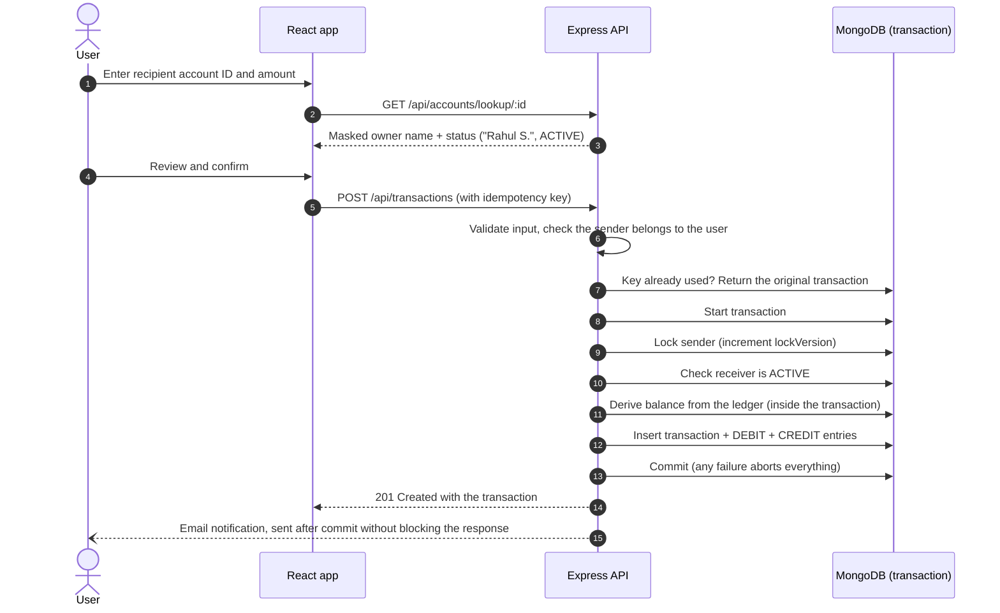

# LedgerX: Banking Ledger & Transaction Management System

A full-stack double-entry banking ledger. Balances are derived from an immutable ledger, transfers are atomic and idempotent, and concurrent transfers can never overdraw an account.

[](https://banking-ledger-lpzw.onrender.com)


**Try it:** open the [live demo](https://banking-ledger-lpzw.onrender.com) and click **Explore the demo account**. No sign-up needed; the demo account is pre-funded with sample transactions.

> The demo runs on Render's free tier, which sleeps after 15 minutes of inactivity. The first request can take 30 to 60 seconds while it wakes up.


| Review before sending | Admin console (dark theme) |
|---|---|
|  |  |

| Sign in | Dark theme | Mobile |
|---|---|---|
|  |  |  |

---

## Highlights

- **Double-entry bookkeeping.** Every transfer writes exactly one `DEBIT` and one `CREDIT` entry. The sum of all debits always equals the sum of all credits.
- **Derived balances.** There is no `balance` field to tamper with: an account's balance is aggregated from its ledger entries on every read.
- **Immutable ledger.** Every ledger field is marked immutable, and Mongoose pre-hooks reject update and delete queries (`updateOne`, `findOneAndUpdate`, `deleteMany`, ...) on ledger entries.
- **Atomic transfers.** The transaction record and both ledger entries are written in one MongoDB transaction, so a failure leaves nothing behind.
- **No double spending.** Concurrent transfers from the same account are serialized with a sender lock (see [below](#why-transfers-lock-the-sender)). Verified on a real replica set: 5 parallel transfers of ₹40,000 against a ₹45,000 balance let exactly 1 through.
- **Idempotent API.** Retrying a request with the same idempotency key returns the original transaction instead of moving money twice, even when the retries race each other.
- **Recipient confirmation.** Before sending, the app looks up the destination account and shows a masked owner name ("Rahul S."), then asks for confirmation on a review screen.
- **Role-based admin console.** Admins approve, freeze and unfreeze accounts, fund users from a system reserve, and audit the global ledger, every transaction and revoked sessions.
- **Revocable sessions.** JWTs are blacklisted on logout (with a TTL index that cleans them up), so a logged-out token can never be reused.
- **Polished UI.** Light and dark themes (following the OS by default), responsive layout with a mobile navigation drawer, loading, empty and error states on every page.

---

## How a transfer works



### Why transfers lock the sender

Checking the balance and then inserting ledger entries is not safe under concurrency, even inside a MongoDB transaction. Two transfers that start at the same time both read the same balance from their snapshot, both pass the check, and both insert *different* ledger documents. Because they never write the same document, MongoDB sees no conflict and commits both. This anomaly is called **write skew**, and it lets the balance go negative.

The fix is to make every outgoing transfer write to the sender's account document first (`$inc: { lockVersion: 1 }`). Now two concurrent transfers from the same account do conflict: MongoDB aborts one with a `WriteConflict`, `session.withTransaction()` retries it, and on the retry it sees the first transfer's ledger entries and the reduced balance.

Measured against a MongoDB 7 replica set:

| Scenario | Before the fix | After the fix |
|---|---|---|
| ₹45,000 balance, 5 parallel transfers of ₹40,000 | 3 succeeded, balance **−₹75,000** | 1 succeeded, balance **₹5,000** |
| ₹9,100 balance, 20 parallel transfers of ₹1,000 | not measured | 9 succeeded, balance **₹100** |
| Same idempotency key sent 5 times in parallel | not measured | **1** transaction created |

The logic lives in [`backend/src/services/transfer.service.js`](backend-ledger/backend/src/services/transfer.service.js).

---

## Features

### For users
- Register, then wait for an admin to approve the account (a banner explains the wait and transfers stay disabled until then)
- One-click demo login
- Total balance across accounts, plus per-account balances derived from the ledger
- Open additional accounts
- Three-step transfers: form with live recipient lookup and balance validation, review, and a receipt with the transaction ID
- Ledger history showing "Sent to" and "Received from" for every entry, with search and credit/debit filters

### For admins
- System overview: users, ledger entries, completed transfer volume, revoked sessions
- Approve pending accounts, freeze and unfreeze active ones, search and filter users by status
- Fund any account from the system reserve (recorded as a normal double-entry transfer)
- Global ledger, every transaction with its idempotency key, and the list of revoked sessions

---

## Tech stack

| Layer | Technologies |
|---|---|
| Frontend | React 18, Vite 5, React Router 6, TanStack Query 5, Tailwind CSS 3 (CSS-variable theme tokens), Framer Motion, Axios, Lucide icons, ESLint |
| Backend | Node.js 20+, Express 5, Mongoose 9, JSON Web Tokens, bcryptjs, Nodemailer |
| Database | MongoDB replica set or Atlas (multi-document transactions) |
| Hosting | Render (a single web service serves both the API and the built frontend) |

---

## Project structure

```plaintext
backend-ledger/
├── backend/                        Express API
│   ├── server.js                   Connects to MongoDB, seeds admin/demo users, starts the server
│   └── src/
│       ├── app.js                  Routes, and serves the built frontend in production
│       ├── controllers/            auth, account, transaction, admin
│       ├── middleware/             JWT auth and system-user (admin) guard
│       ├── models/                 user, account, transaction, ledger (immutable), token blacklist
│       ├── routes/
│       └── services/
│           ├── transfer.service.js Atomic, idempotent transfers with sender locking
│           ├── seed.service.js     Admin and demo user seeding
│           └── email.service.js
└── frontend/                       React + Vite client
    └── src/
        ├── pages/                  User and admin pages, login, register, 404
        ├── components/
        │   ├── ui/                 Button, Input, Card, DataTable, Alert, ... (shared kit)
        │   ├── layout/             App shell and auth split-screen layout
        │   ├── user/               Account card, ledger table, transfer modal
        │   └── admin/              User management, funding modal, revoked tokens
        ├── hooks/queries.js        TanStack Query hooks for every API call
        ├── context/                Auth, theme and toast providers
        └── services/api.js         Axios client with error normalisation and 401 handling
```

---

## API reference

All endpoints are under `/api`. Authenticated requests send the JWT as a cookie or an `Authorization: Bearer` header.

### Auth
| Method | Endpoint | Access | Description |
|---|---|---|---|
| `POST` | `/auth/register` | Public | Create a user and a pending account |
| `POST` | `/auth/login` | Public | Sign in and receive a JWT |
| `POST` | `/auth/demo-login` | Public | Sign in as the demo user (never returns an admin session) |
| `GET` | `/auth/me` | User | Current user, used to validate a stored session |
| `POST` | `/auth/logout` | User | Revoke the current token |

### Accounts
| Method | Endpoint | Access | Description |
|---|---|---|---|
| `GET` | `/accounts` | User | The user's accounts |
| `POST` | `/accounts` | User | Open another account |
| `GET` | `/accounts/balance/:accountId` | Owner | Balance derived from the ledger |
| `GET` | `/accounts/ledger` | User | The user's ledger entries, each with its counterparty account |
| `GET` | `/accounts/lookup/:accountId` | User | Masked owner name and status, used to confirm a recipient |

### Transactions
| Method | Endpoint | Access | Description |
|---|---|---|---|
| `POST` | `/transactions` | Owner of `fromAccount` | Transfer between two accounts |
| `POST` | `/transactions/system/initial-funds` | Admin | Fund an account from the system reserve |

```http
POST /api/transactions
Content-Type: application/json

{
  "fromAccount": "6adbcf80fc6f830769b188ef",
  "toAccount": "6adbcf80fc6f830769b1890a",
  "amount": 1500,
  "idempotencyKey": "3f1c2a9e-7b1d-4c55-9e0a-2a4f6d8b1c33"
}
```

| Status | Meaning |
|---|---|
| `201` | Transfer completed |
| `200` | The idempotency key was already used for this exact transfer; the original transaction is returned |
| `400` | Invalid input, insufficient balance, or an account that is not active |
| `403` | The sending account belongs to someone else |
| `404` | Account not found |
| `409` | The idempotency key was already used for a different transfer |

### Admin (system users only)
| Method | Endpoint | Description |
|---|---|---|
| `GET` | `/admin/users` | All users with their account status |
| `PATCH` | `/admin/users/:userId/status` | Set a user's accounts to `PENDING`, `ACTIVE`, `FROZEN` or `CLOSED` |
| `GET` | `/admin/ledger` | Every ledger entry |
| `GET` | `/admin/transactions` | Every transaction |
| `GET` | `/admin/blocked-tokens` | Revoked sessions |

---

## Running locally

### Prerequisites
- Node.js 20 or newer
- MongoDB **running as a replica set**. Transfers use multi-document transactions, which a standalone `mongod` does not support. Either use a free MongoDB Atlas cluster, or start a single-node replica set with Docker:

```bash
docker run -d --name ledger-mongo -p 27017:27017 mongo:7 --replSet rs0 --bind_ip_all
docker exec ledger-mongo mongosh --eval 'rs.initiate({_id: "rs0", members: [{_id: 0, host: "localhost:27017"}]})'
```

### Backend

```bash
git clone https://github.com/arungujjar123/Banking-ledger-transaction-management-system.git
cd Banking-ledger-transaction-management-system/backend-ledger/backend
npm install
cp .env.example .env   # then edit the values
npm run dev            # API on http://localhost:3000
```

| Variable | Required | Description |
|---|---|---|
| `MONGO_URI` | Yes | Replica set or Atlas connection string, e.g. `mongodb://localhost:27017/banking_ledger?replicaSet=rs0` |
| `JWT_SECRET` | Yes | Long random string used to sign tokens |
| `ADMIN_EMAIL`, `ADMIN_PASSWORD` | Recommended | The admin user and system reserve account are created on startup if missing |
| `DEMO_EMAIL`, `DEMO_PASSWORD` | Optional | Enables the demo login; the demo user is created and funded once |
| `EMAIL_USER` + `EMAIL_PASS`, or `CLIENT_ID` / `CLIENT_SECRET` / `REFRESH_TOKEN` | Optional | Gmail credentials for notification emails (app password or OAuth2) |
| `PORT` | Optional | Defaults to `3000` |

### Frontend

```bash
cd ../frontend
npm install
npm run dev            # http://localhost:5173, proxies /api to the backend
npm run lint
```

Sign in with the `ADMIN_EMAIL` / `ADMIN_PASSWORD` you configured, or use **Explore the demo account** if the demo variables are set.

---

## Deployment

The app deploys as **one Render web service**: Express serves the API and the built React app from the same origin, so there is no CORS setup and cookies just work.

| Setting | Value |
|---|---|
| Root directory | `backend-ledger` |
| Build command | `cd frontend && npm install && npm run build && cd ../backend && npm install` |
| Start command | `cd backend && npm start` |
| Health check path | `/health` |

Set the environment variables from the table above in the Render dashboard. [`render.yaml`](render.yaml) describes the same setup as a Render Blueprint.

---

## Security notes

- Passwords are hashed with bcrypt and never returned by the API
- Users can only send money from accounts they own; admin routes require a system user
- Logged-out JWTs are blacklisted until they expire
- The demo login can never produce an admin session, even if misconfigured
- Recipient lookup returns only a masked name and an account status
- Admin credentials come from environment variables; nothing secret is committed

---

## Roadmap

- Automated tests (Jest + Supertest against a MongoDB replica set) and a GitHub Actions pipeline
- Rate limiting on auth endpoints, `httpOnly` / `secure` / `sameSite` cookie flags, and `helmet`
- Store amounts as integer paise instead of floating-point rupees
- Rely on the `httpOnly` cookie alone and stop keeping the token in `localStorage`

---

## License

ISC
