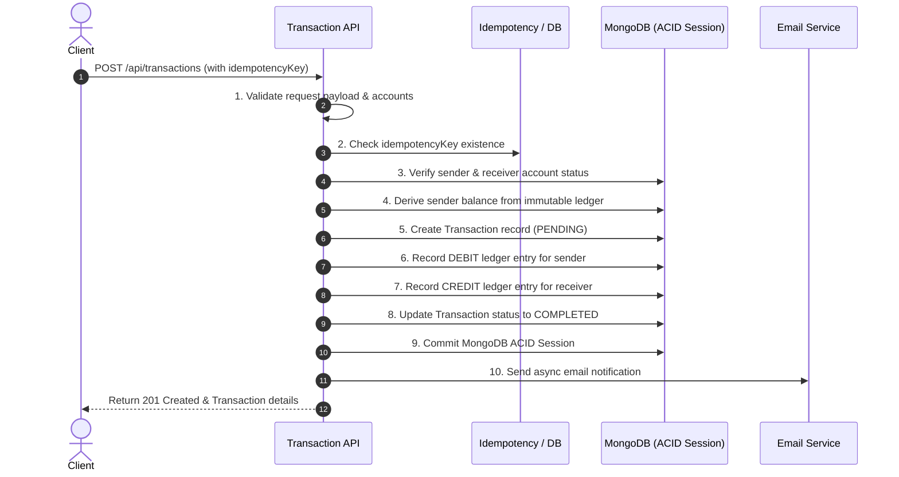

# 🏦 Banking Ledger & Transaction Management System

A production-grade, double-entry banking ledger and transaction management system designed for immutable audit trails, ACID-compliant money transfers, idempotency control, and role-based real-time dashboards.


---

## 🌟 Features

### 👤 User Features
* **Account Creation & Multi-Currency Support**: Open and maintain accounts (e.g. INR) with real-time status tracking.
* **Double-Entry Fund Transfers**: Transfer funds securely to any destination account with automatic balance derivation.
* **Strict Idempotency Protection**: Every transaction request requires a unique `idempotencyKey` to prevent accidental double-spending or duplicate charges on network retries.
* **Derived Balance Calculation**: Balances are calculated dynamically by aggregating verified historical ledger entries, preventing balance manipulation.
* **Instant Email Notifications**: Automated email alerts for debited and credited accounts via Nodemailer (OAuth2 / SMTP).
* **Personal Transaction & Ledger History**: Inspect detailed chronological debit/credit ledger records and transfer statuses (`PENDING`, `COMPLETED`, `FAILED`, `REVERSED`).

### 🛡️ Admin Features
* **Comprehensive Dashboard**: View system-wide metrics including total accounts, circulating balances, users, and transactions.
* **Full Ledger Audit Trail**: Centralized access to every single ledger movement across all user accounts in the system.
* **User Lifecycle Management**: Monitor registered users and toggle account statuses (`ACTIVE`, `SUSPENDED`, `FROZEN`).
* **Session & Security Oversight**: Inspect blacklisted / invalidated JWT tokens to monitor logout security and session revocations.
* **Initial Capital Allocation**: Privileged system user account to seed initial liquidity safely into customer accounts.

### ⚙️ Financial Ledger Engine
* **Strict Double-Entry Bookkeeping**: Every transaction creates atomic, balanced `DEBIT` and `CREDIT` ledger records.
* **Immutable Ledger Records**: Enforced at the schema level—MongoDB pre-hooks reject any update, delete, or replace operations.
* **ACID Transactions**: MongoDB session transactions ensure atomicity; if any step fails, the entire transfer cleanly rolls back.
* **JWT Blacklist Architecture**: Server-side token blacklisting on logout to thwart token replay attacks.

---

## 🔄 The 10-Step Transaction Lifecycle



---

## 🏗️ Architecture & Tech Stack

| Layer | Technologies |
|---|---|
| **Frontend** | React 18, Vite 5, TailwindCSS, React Router v6, Lucide Icons, Framer Motion, Axios |
| **Backend** | Node.js (v20+), Express.js v5, Cookie-Parser, Dotenv |
| **Database & ODM** | MongoDB, Mongoose 9 (with ACID Transaction Sessions & Pre-hook Immutability) |
| **Authentication & Security** | JSON Web Tokens (JWT), BcryptJS, Cookie-based token handling, Blacklist Model |
| **Mailing / Notifications** | Nodemailer (Google OAuth2 & standard SMTP fallback) |

---

## 📁 Project Directory Structure

```plaintext
Banking-ledger-transaction-management-system/
│
├── README.md                                  # Repository documentation
└── backend-ledger/
    ├── backend/                               # Express.js REST API
    │   ├── server.js                          # Server bootstrapper & DB connection
    │   ├── package.json                       # Backend dependencies & scripts
    │   └── src/
    │       ├── app.js                         # Express application setup & middleware
    │       ├── config/
    │       │   └── db.js                      # MongoDB connection logic
    │       ├── controllers/
    │       │   ├── auth.controller.js         # Register, Login, Logout (blacklist)
    │       │   ├── account.controller.js      # Account creation, balance, user ledger
    │       │   ├── transaction.controller.js  # 10-step atomic transfer flow
    │       │   └── admin.controller.js        # Admin metrics, user & ledger control
    │       ├── middleware/
    │       │   └── auth.middleware.js         # JWT auth & system user validation
    │       ├── models/
    │       │   ├── user.model.js              # User schema with hashed passwords
    │       │   ├── account.model.js           # Bank account records
    │       │   ├── transaction.model.js       # Transaction headers & idempotency
    │       │   ├── ledger.model.js            # Immutable double-entry ledger
    │       │   └── blackList.model.js         # Revoked JWT tokens with TTL index
    │       ├── routes/                        # API Route definitions
    │       ├── scripts/
    │       │   └── seedAdmin.js               # CLI script to seed system administrator
    │       └── services/
    │           └── email.service.js           # Transaction email notifications
    │
    └── frontend/                              # React + Vite Client Application
        ├── package.json                       # Frontend dependencies & scripts
        ├── vite.config.js                     # Vite build & API reverse proxy configuration
        ├── tailwind.config.js                 # Tailwind styling rules
        └── src/
            ├── App.jsx                        # Application router & route guards
            ├── main.jsx                       # React root entry point
            ├── components/                    # Modular UI components (User & Admin)
            ├── context/                       # Authentication & global application state
            ├── pages/
            │   ├── Login.jsx                  # User / Admin authentication
            │   ├── Register.jsx               # New user onboarding
            │   ├── UserDashboard.jsx          # Balance & quick actions
            │   ├── UserAccounts.jsx           # Bank account listing
            │   ├── UserTransactions.jsx       # Money transfers & transaction list
            │   ├── AdminDashboard.jsx         # Administrative analytics
            │   ├── AdminUsers.jsx             # User account status controls
            │   ├── AdminTransactions.jsx      # System-wide transaction log
            │   ├── AdminLedger.jsx            # System-wide double-entry ledger records
            │   └── AdminBlockedTokens.jsx     # Security & token audit page
            └── services/
                └── api.js                     # Centralized Axios HTTP client
```

---

## 🚀 Getting Started

### 📋 Prerequisites
* **Node.js** (v18 or v20+ recommended)
* **npm** or **yarn**
* **MongoDB** (Local instance or MongoDB Atlas cluster URI)

---

### 1️⃣ Clone the Repository
```bash
git clone https://github.com/arungujjar123/Banking-ledger-transaction-management-system.git
cd Banking-ledger-transaction-management-system
```

---

### 2️⃣ Backend Setup

1. Navigate to the backend folder:
   ```bash
   cd backend-ledger/backend
   ```

2. Install dependencies:
   ```bash
   npm install
   ```

3. Create your `.env` configuration file in `backend-ledger/backend/.env`:
   ```env
   PORT=3000
   MONGO_URI=your_mongodb_connection_string
   JWT_SECRET=your_super_secret_jwt_key
   
   # Email Configuration (OAuth2 or SMTP)
   EMAIL_USER=your_email@gmail.com
   EMAIL_PASS=your_gmail_app_password
   # Or OAuth2:
   CLIENT_ID=your_google_client_id
   CLIENT_SECRET=your_google_client_secret
   REFRESH_TOKEN=your_google_refresh_token
   ```

4. Seed the System Administrator and System Account:
   ```bash
   npm run seed:admin
   ```

5. Start the backend server:
   ```bash
   # Development mode with nodemon
   npm run dev

   # Production mode
   npm start
   ```
   > The API will start at: `http://localhost:3000`

---

### 3️⃣ Frontend Setup

1. Open a new terminal and navigate to the frontend folder:
   ```bash
   cd backend-ledger/frontend
   ```

2. Install dependencies:
   ```bash
   npm install
   ```

3. Start the Vite development server:
   ```bash
   npm run dev
   ```
   > The web app will launch at: `http://localhost:5173`

---

## 🔑 Administrator Account

Set `ADMIN_EMAIL` and `ADMIN_PASSWORD` in `backend/.env`. The admin user and its system account are created automatically when the server starts (or run `npm run seed:admin` manually). Log in with those credentials to access the Admin Suite:

| Parameter | Value |
|---|---|
| **Role** | System Administrator |
| **Email** | value of `ADMIN_EMAIL` |
| **Password** | value of `ADMIN_PASSWORD` |
| **Permissions** | System-wide Ledger, User Management, Initial Fund Distribution |

---

## 📡 API Reference

### 🔐 Authentication (`/api/auth`)
| Method | Endpoint | Description | Auth Required |
|---|---|---|:---:|
| `POST` | `/api/auth/register` | Register a new user | ❌ |
| `POST` | `/api/auth/login` | Authenticate and receive JWT cookie | ❌ |
| `POST` | `/api/auth/logout` | Invalidate token & store in blacklist | ✅ |

### 💳 Accounts (`/api/accounts`)
| Method | Endpoint | Description | Auth Required |
|---|---|---|:---:|
| `POST` | `/api/accounts/` | Create a new bank account | ✅ |
| `GET` | `/api/accounts/` | Get all accounts for logged-in user | ✅ |
| `GET` | `/api/accounts/ledger` | Fetch ledger entries for user's accounts | ✅ |
| `GET` | `/api/accounts/balance/:accountId` | Retrieve current derived balance | ✅ |

### 💸 Transactions (`/api/transactions`)
| Method | Endpoint | Description | Auth Required |
|---|---|---|:---:|
| `POST` | `/api/transactions/` | Execute idempotent money transfer | ✅ |
| `POST` | `/api/transactions/system/initial-funds`| Inject initial liquidity | 🛡️ System User |

### 🛡️ Administration (`/api/admin`)
| Method | Endpoint | Description | Auth Required |
|---|---|---|:---:|
| `GET` | `/api/admin/users` | List all users and account statuses | 🛡️ Admin |
| `GET` | `/api/admin/ledger` | Global view of all ledger entries | 🛡️ Admin |
| `GET` | `/api/admin/transactions` | Global audit log of all transactions | 🛡️ Admin |
| `GET` | `/api/admin/blocked-tokens` | List revoked/blacklisted JWT sessions | 🛡️ Admin |
| `PATCH` | `/api/admin/users/:userId/status`| Update user account status | 🛡️ Admin |

---

## 🔒 Security & Data Integrity Highlights

* 🛡️ **Zero Direct Balance Modification**: Balances are never stored as a raw mutable number. They are derived directly from signed immutable ledger entries, eliminating unauthorized modifications.
* 🛡️ **Strict Schema Protection**: Mongoose hooks strictly block `findOneAndUpdate`, `updateOne`, `deleteOne`, etc. on ledger items.
* 🛡️ **Idempotency Guarantee**: Eliminates repeat transactions if network drops or users press submit repeatedly.
* 🛡️ **JWT Blacklisting with TTL**: Revoked tokens are saved in MongoDB with auto-expiration TTL matching the token expiry.
* 🛡️ **Password Security**: Passwords are hashed with `bcryptjs` using salted rounds.

---

## 📄 License

This project is licensed under the [ISC License](LICENSE).
